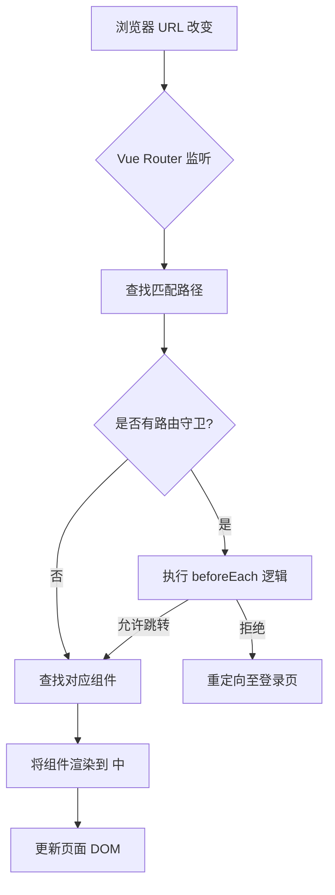

# 前端 - 【Vue3】Vue Router 4 路由全解 - 个人文章


在 Vue3 前端开发中，**Vue Router 4** 是官方标配的路由管理器，承担着单页面应用（SPA）页面切换、参数传递、权限控制、路由守卫等核心功能。区别于 Vue2 所用的 Vue Router 3，Vue3 必须使用 **Vue Router 4** 版本，API 设计更贴合 Composition API，用法更简洁高效。

本文完整覆盖 Vue Router 4 **12 大核心知识点**，从基础理解、配置、切换效果，到嵌套路由、传参、编程式导航、重定向等实战功能。掌握本文内容，即可应对 Vue3 前端开发中 99% 的路由场景，是 Vue 开发者必备的核心技能。

___
核心架构图解




## 1 对路由的理解

**核心定义**

**路由（Route）** 本质是 **URL 路径与 Vue 组件的映射关系**；**路由器（Router）** 是管理所有路由规则、实现路径切换、组件渲染的核心管理器。

在 Vue 单页面应用中，路由的核心价值：

1.  实现**无刷新页面切换**，提升用户体验，符合 SPA 应用核心特性；
2.  统一管理页面路径与组件的对应关系，便于项目维护和扩展；
3.  支持路由传参、嵌套路由、路由守卫等功能；
4.  配合浏览器历史记录，实现前进、后退等原生交互效果。

**核心概念区分**

1.  **路由（Route）**：单条路径规则，如 `/home` 对应 Home 组件；
2.  **路由器（Router）**：管理所有路由规则的实例，全局唯一；
3.  **路由组件**：通过路由规则渲染的页面级组件（存放于 `pages/views` 目录）；
4.  **一般组件**：通过标签手动引入的公共组件（存放于 `components` 目录）；
5.  **RouterLink**：路由导航组件，替代原生 `<a>` 标签，实现无刷新跳转；
6.  **RouterView**：路由占位组件，匹配到路由规则后，自动渲染对应组件。

___

## 2 基本切换效果（Vue Router 4 基础配置）

Vue3 中**强制使用 Vue Router 4**，不兼容低版本，项目标准配置如下：

**第一步：安装依赖**

```
# npm 安装
npm install vue-router@4
# yarn 安装
yarn add vue-router@4
# pnpm 安装（主流）
pnpm add vue-router@4
```

**第二步：创建路由配置文件（标准目录结构）**

项目标准路径：`src/router/index.ts`

```js
// 1. 从 vue-router 4 导入核心方法
import { createRouter, createWebHistory } from 'vue-router'

// 2. 导入路由组件（页面级组件）
import Home from '@/pages/Home.vue'
import News from '@/pages/News.vue'
import About from '@/pages/About.vue'

// 3. 创建路由器实例
const router = createRouter({
  // 配置路由模式（history 模式，首选）
  history: createWebHistory(),
  // 路由规则数组：路径与组件的映射关系
  routes: [
    {
      path: '/home',    // 访问路径
      component: Home   // 匹配路径后渲染的组件
    },
    {
      path: '/news',
      component: News
    },
    {
      path: '/about',
      component: About
    }
  ]
})

//  导出路由器实例，供 main.ts 使用
export default router
```

**第三步：在入口文件注册路由**

项目标准入口：`src/main.ts`

```js
import { createApp } from 'vue'
import App from './App.vue'
// 导入路由实例
import router from './router/index'

const app = createApp(App)

// 全局注册路由（核心步骤）
app.use(router)

// 挂载应用
app.mount('#app')
```

**第四步：根组件编写导航与占位区（App.vue）**

```js
<template>
  <div class="app">
    <h2 class="title">Vue路由测试</h2>

    <!-- 导航区：RouterLink 实现路由跳转 -->
    <div class="navigate">
      <!-- to：目标路径；active-class：激活时的样式类名 -->
      <RouterLink to="/home" active-class="active">首页</RouterLink>
      <RouterLink to="/news" active-class="active">新闻</RouterLink>
      <RouterLink to="/about" active-class="active">关于</RouterLink>
    </div>

    <!-- 展示区：RouterView 路由占位符，匹配的组件在此渲染 -->
    <div class="main-content">
      <RouterView></RouterView>
    </div>
  </div>
</template>

<!-- Vue3 + TS + setup 语法糖（标准写法） -->
<script lang="ts" setup name="App">
// 导入路由核心组件
import { RouterLink, RouterView } from 'vue-router'
</script>

<style scoped>
/* 基础样式 */
.app {
  width: 1200px;
  margin: 0 auto;
}
.navigate {
  margin: 20px 0;
}
.navigate a {
  margin: 0 10px;
  color: #333;
}
/* 路由激活样式 */
.active {
  color: #1989fa !important;
  font-weight: bold;
}
.main-content {
  padding: 20px;
  border: 1px solid #eee;
  min-height: 300px;
}
</style>
```

**效果说明**

点击导航按钮，URL 无刷新切换，`RouterView` 位置自动渲染对应组件，实现基础路由切换。

即： 页面不整个刷新、不白屏、不重新加载，但浏览器地址栏的网址变了，页面内容也跟着变了，页面局部内容替换。

___

## 3 两个核心注意点（开发规范）

**1\. 组件目录划分规范**

|**组件类型**|**存放目录**|**定义**|**示例**|
|---|---|---|---|
|路由组件|`pages` / `views`|靠路由规则渲染的页面级组件|Home、News、About|
|一般组件|`components`|手动编写标签引入的公共组件|Header、Footer、Table|

**意义**：目录结构清晰，便于多人协作开发，快速区分页面组件与公共组件。

**2\. 路由组件的挂载 / 卸载机制**

-   默认行为：通过导航切换时，**上一个路由组件会被卸载（unmounted）**，新组件被挂载（mounted）；
-   场景：组件卸载会销毁数据、定时器、事件监听，避免内存泄漏；
-   特殊需求：需要缓存路由组件时，使用 `<KeepAlive>` 包裹 `RouterView`（后续高阶知识点）。

___

## 4 路由器工作模式（必选配置）

Vue Router 4 提供 **history** 和 **hash** 两种模式，开发优先选择 `history` 模式。

### 1\. history 模式（推荐）

```js
import { createWebHistory } from 'vue-router'
const router = createRouter({
  history: createWebHistory(), // 开启 history 模式
  routes: []
})
```

-   优点：URL 美观无 `#`，贴近传统网站，SEO 优化效果更好；
-   缺点：项目上线需要**服务端配置**（Nginx/Node.js），否则刷新页面会报 404；

**真实网址长这样**

```
https://www.xxx.com/home
https://www.xxx.com/news
https://www.xxx.com/about
```

**特点（看一眼就懂）**

-   **没有 #**
-   网址干净、好看、像传统网站
-   **用户看着舒服**
-   **搜索引擎更喜欢（SEO 更好）**

**缺点（真实场景）**

你部署上线后：

-   正常点击跳转：没问题
-   **一按 F5 刷新 → 直接报 404 页面不存在**

**为什么会 404？**

因为 `/home` 不是服务器真实存在的文件，是前端路由虚拟出来的。**必须让后端 / 运维配置 Nginx 指向 index.html 才能解决。**

### 2\. hash 模式（兼容优先）

```js
import { createWebHashHistory } from 'vue-router'
const router = createRouter({
  history: createWebHashHistory(), // 开启 hash 模式
  routes: []
})
```

-   优点：兼容性极强，无需服务端配置，刷新无 404；
-   缺点：URL 携带 `#` 不美观，SEO 优化效果差；
-   适用场景：内网系统、无需 SEO 的后台管理系统。

**真实网址长这样**

```
https://www.xxx.com/#/home
https://www.xxx.com/#/news
https://www.xxx.com/#/about
```

**特点（看一眼就懂）**

-   **带 # 号**
-   网址不太美观
-   **\# 后面的内容永远不会发给服务器**
-   **刷新永远不会 404**（最稳）

**优点（真实场景）**

不管怎么刷新：

-   永远不会 404
-   不用找后端配 Nginx
-   上线即跑，零配置

**缺点**

-   网址丑
-   SEO 不友好（搜索引擎不解析 # 后面内容）

___

## 5 to 的两种写法（RouterLink 核心用法）

`to` 属性用于指定跳转目标，支持**字符串**和**对象**两种写法，开发按需使用。

### 1\. 字符串写法（简单场景）

适合无参数、固定路径的跳转，语法简洁：

```js
<RouterLink active-class="active" to="/home">首页</RouterLink>
```

### 2\. 对象写法（复杂场景）

适合传参、命名路由跳转，扩展性更强：

```js
<RouterLink active-class="active" :to="{ path: '/home' }">首页</RouterLink>
```

注意：对象写法必须加**冒号（v-bind）**，否则会被解析为普通字符串。

___

## 6 命名路由（简化路由写法）

**核心作用**

给路由规则设置 `name` 属性，**通过名称跳转路由**，避免硬编码长路径，简化嵌套路由、传参写法。

**1\. 配置命名路由**

```js
const routes = [
  {
    name: 'zhuye',    // 路由名称（唯一，建议语义化）
    path: '/home',
    component: Home
  },
  {
    name: 'xinwen',
    path: '/news',
    component: News
  },
  {
    name: 'guanyu',
    path: '/about',
    component: About
  }
]
```

**2\. 基于命名路由跳转**

```js
<!-- 传统写法：路径跳转（硬编码，维护麻烦） -->
<RouterLink to="/about">关于</RouterLink>
<RouterLink :to="{ path: '/about' }">关于</RouterLink>

<!-- 命名路由写法：名称跳转（推荐，维护便捷） -->
<RouterLink :to="{ name: 'guanyu' }">关于</RouterLink>
```

___

## 7 嵌套路由（多级页面核心）

**应用场景**

页面内部包含子页面（如：新闻列表 → 新闻详情、用户中心 → 个人信息），必须使用嵌套路由实现。

**实战步骤**

1.  **创建子路由组件**：`src/pages/News/Detail.vue`
2.  **配置子路由规则（children）**

```js
const router = createRouter({
  history: createWebHistory(),
  routes: [
    {
      name: 'zhuye',
      path: '/home',
      component: Home
    },
    {
      name: 'xinwen',
      path: '/news',
      component: News,
      // 子路由配置（核心）
      children: [
        {
          name: 'xiangqing',
          path: 'detail', // 子路径无需加 /，自动拼接父路径
          component: () => import('@/pages/News/Detail.vue') // 路由懒加载（优化）
        }
      ]
    },
    {
      name: 'guanyu',
      path: '/about',
      component: About
    }
  ]
})
```

1.  **父组件预留子路由占位符**（News.vue）

```js
<template>
  <div class="news">
    <h3>新闻列表</h3>
    <!-- 子路由导航 -->
    <RouterLink :to="{ path: '/news/detail' }">查看新闻详情</RouterLink>
    <!-- 子路由渲染占位符 -->
    <RouterView />
  </div>
</template>
```

1.  **跳转写法**

```js
<!-- 完整路径跳转 -->
<RouterLink to="/news/detail">详情</RouterLink>
<!-- 命名路由跳转（推荐） -->
<RouterLink :to="{ name: 'xiangqing' }">详情</RouterLink>
```

___

## 8 路由传参（数据传递核心）

路由传参是页面间数据传递的核心方式，分为 **query 参数** 和 **params 参数**，用法与限制完全不同，必须严格区分。

### 8.1、query 参数（常用，无强制限制）

**1\. 传递参数**

```js
<!-- 写法1：字符串拼接（不推荐，复杂参数易出错） -->
<RouterLink to="/news/detail?id=1&title=Vue教程">详情</RouterLink>

<!-- 写法2：对象写法（推荐） -->
<RouterLink 
  :to="{
    path: '/news/detail',
    query: {
      id: 1,
      title: 'Vue Router 实战教程'
    }
  }"
>
  查看详情
</RouterLink>
```

**2\. 接收参数（子组件）**

```js
<script lang="ts" setup>
// 导入获取路由参数的 hook
import { useRoute } from 'vue-router'
const route = useRoute()

// 获取 query 参数
console.log(route.query) // { id: '1', title: 'Vue Router 实战教程' }
const { id, title } = route.query
</script>
```

### 8.2、params 参数（路径参数，有严格限制）

**1\. 前置配置：路由占位**

```js
// 路由规则必须提前占位
children: [
  {
    name: 'xiangqing',
    // 占位：id/title/content 为 params 参数名
    path: 'detail/:id/:title/:content', 
    component: Detail
  }
]
```

**2\. 传递参数**

```js
<!-- 写法1：字符串模板拼接 -->
<RouterLink :to="`/news/detail/1/Vue教程/路由核心`">详情</RouterLink>

<!-- 写法2：对象写法（必须用 name，不能用 path！！！） -->
<RouterLink 
  :to="{
    name: 'xiangqing', // 强制使用 name，path 无效
    params: {
      id: 1,
      title: 'Vue教程',
      content: '路由核心'
    }
  }"
>
  查看详情
</RouterLink>
```

**3\. 接收参数**

```js
<script lang="ts" setup>
import { useRoute } from 'vue-router'
const route = useRoute()

// 获取 params 参数
console.log(route.params) // { id: '1', title: 'Vue教程', content: '路由核心' }
</script>
```

**核心区别**

|**参数类型**|**路径显示**|**配置要求**|**跳转限制**|
|---|---|---|---|
|query|`?key=value`|无需占位|支持 path/name|
|params|`/value`|必须占位|仅支持 name|

___

## 9 路由的 props 配置（简化参数接收）

**核心作用**

将路由参数（query/params）转化为组件的 `props`，**解耦路由与组件**，让组件更通用、便于单元测试。

**三种配置写法**

```js
{
  name: 'xiangqing',
  path: 'detail/:id/:title',
  component: Detail,
  // 写法1：布尔值（仅传递 params 参数）
  // props: true

  // 写法2：对象（静态参数，固定值）
  // props: { type: 'news', status: 'published' }

  // 写法3：函数（首选，可自定义传递参数）
  props(route) {
    // 合并 query + params 参数
    return {
      ...route.params,
      ...route.query
    }
  }
}
```

**组件接收（直接用 props 接收）**

```
<script lang="ts" setup>
// 直接接收路由参数，无需 useRoute
const props = defineProps<{
  id: string
  title: string
}>()
console.log(props.id, props.title)
</script>
```

___

## 10 replace 属性（控制浏览器历史记录）

**核心作用**

控制路由跳转时浏览器历史记录的写入模式，避免返回时出现冗余页面。

**两种模式**

1.  **push（默认）**：追加历史记录，点击返回可回到上一页；
2.  **replace**：替换当前记录，点击返回会跳过当前页。

**开启 replace 模式**

```js
<!-- 标签式开启 -->
<RouterLink replace to="/news">新闻</RouterLink>

<!-- 完整写法 -->
<RouterLink :replace="true" to="/news">新闻</RouterLink>
```

___

## 11 编程式导航（核心用法）

**场景**

通过**JS 代码**实现路由跳转（如：登录成功后跳转、表单提交后跳转），替代 `RouterLink` 标签。

**Vue3 标准写法（Composition API）**

```js
<script lang="ts" setup>
// 导入两个核心 hook
import { useRoute, useRouter } from 'vue-router'

// useRoute：获取当前路由信息（参数、路径等）
const route = useRoute()
// useRouter：路由器实例，执行跳转逻辑
const router = useRouter()

// 1. push 跳转（追加历史记录）
const goHome = () => {
  router.push('/home')
  // 对象写法
  router.push({ name: 'zhuye' })
  // 传参写法
  router.push({ path: '/news/detail', query: { id: 1 } })
}

// 2. replace 跳转（替换历史记录）
const goAbout = () => {
  router.replace({ name: 'guanyu' })
}

// 3. 前进/后退
const goBack = () => router.back()
const goForward = () => router.forward()
</script>
```

___

## 12 重定向（项目必备）

**核心作用**

将默认路径 `/` 重定向到指定页面，解决项目启动后空白页问题。

**标准配置**

```js
const routes = [
  // 重定向规则（放在最前面）
  {
    path: '/',          // 根路径
    redirect: '/home'   // 重定向目标路径
    // 命名路由写法（推荐）
    // redirect: { name: 'zhuye' }
  },
  // 其他路由规则
  { path: '/home', component: Home }
]
```

效果：项目启动访问 `http://localhost:5173/`，自动跳转到 `http://localhost:5173/home`。


## 1\. 什么是 beforeEach？

`beforeEach` 是 Vue Router 提供的 **全局前置守卫（Global Before Guards）**，在路由跳转 **之前** 触发。它的核心作用是：

-   **拦截导航**：在用户访问某个路由前进行权限校验、数据预加载等操作。
-   **控制跳转行为**：允许继续导航、重定向到其他页面，或直接中断跳转。

它是实现以下功能的关键机制：

-   登录状态验证
-   动态路由加载（如权限路由）
-   页面访问统计
-   路由切换动画控制

___

### 2\. 基本语法与参数解析

#### 语法结构

```javascript
const router = new VueRouter({ ... });

router.beforeEach((to, from, next) => {
  // 逻辑处理
  next(); // 必须调用！
});
```

#### 参数详解

|参数|类型|说明|
|---|---|---|
|`to`|`Route`|**目标路由对象**，包含 `path`、`params`、`query`、`meta` 等属性。|
|`from`|`Route`|**当前路由对象**，即正要离开的路由。|
|`next`|`Function`|**必须调用**的函数，决定是否放行、重定向或中断导航。|

___

### 3\. next() 的 4 种调用方式

#### 3.1 放行导航

```javascript
next(); 
```

-   **行为**：直接允许导航到 `to` 路由。
-   **场景**：无需拦截的公共页面（如首页、帮助页）。

___

#### 3.2 中断导航

```javascript
next(false); 
```

-   **行为**：取消当前导航，用户停留在 `from` 路由。
-   **场景**：用户无权访问目标路由时阻止跳转。

___

#### 3.3 重定向到其他路由

```javascript
next('/login'); 
// 或
next({ path: '/login', query: { redirect: to.path } });
```

-   **行为**：强制跳转到指定路径。
-   **场景**：用户未登录时重定向到登录页，并记录原目标路径。

___

#### 3.4 标记错误

```javascript
next(new Error('Network Error')); 
```

-   **行为**：导航被终止，错误会传递给 `router.onError()`。
-   **场景**：处理异步操作中的异常（如接口请求失败）。

___

### 4\. 常见使用场景与 代码示例

#### 4.1 登录状态验证

```javascript
router.beforeEach((to, from, next) => {
  const isLoggedIn = localStorage.getItem('token');
  if (to.meta.requiresAuth && !isLoggedIn) {
    next({ path: '/login', query: { redirect: to.fullPath } });
  } else {
    next();
  }
});
```

-   **说明**：若目标路由需要登录（通过 `meta.requiresAuth` 标记），但用户未登录，则重定向到登录页。

___

#### 4.2 动态路由加载（权限控制）

```javascript
router.beforeEach(async (to, from, next) => {
  if (用户已加载权限路由) {
    next();
    return;
  }

  try {
    const roles = await fetchUserRoles(); // 异步获取用户角色
    const accessRoutes = generateRoutes(roles); // 根据角色生成路由
    router.addRoutes(accessRoutes); // 动态添加路由
    next({ ...to, replace: true }); // 强制重新导航
  } catch (error) {
    next('/error');
  }
});
```

-   **说明**：根据用户角色动态添加路由，并通过 `next({ ...to, replace: true })` 确保路由表更新。

___

#### 4.3 页面访问统计

```javascript
router.beforeEach((to, from, next) => {
  logPageView(to.path); // 上报页面访问数据
  next();
});
```

-   **说明**：在跳转前记录用户访问路径，用于数据分析。

___

### 5\. 动态路由加载的实践技巧

#### 5.1 解决 异步路由加载的时序问题

动态添加路由后，直接调用 `next()` 可能导致目标路由尚未 注册 ，需通过以下写法强制重新导航：

```javascript
next({ ...to, replace: true });
```

-   **原理**：`{ ...to }` 保留原始路由信息，`replace: true` 替换浏览器历史记录。
-   **效果**：确保路由表更新后重新触发导航流程。

___

#### 5.2 避免路由重复添加

在路由守卫中添加状态标记，防止多次加载：

```javascript
let isRoutesLoaded = false;

router.beforeEach((to, from, next) => {
  if (isRoutesLoaded) {
    next();
    return;
  }

  loadRoutes().then(() => {
    isRoutesLoaded = true;
    next({ ...to, replace: true });
  });
});
```

___

### 6\. 常见陷阱与避坑指南

#### 6.1 忘记调用 next()

```javascript
router.beforeEach((to, from, next) => {
  if (someCondition) {
    // 忘记调用 next()，导航被挂起！
  }
});
```

-   **后果**：页面卡住，无法跳转。
-   **修复**：确保所有逻辑分支都调用 `next()`。

___

#### 6.2 重定向循环

```javascript
router.beforeEach((to, from, next) => {
  if (to.path === '/login') {
    next();
    return;
  }

  if (!isLoggedIn) {
    next('/login'); // 若未登录，重定向到登录页
  } else {
    next();
  }
});
```

-   **问题**：若登录页本身需要权限（如 `meta.requiresAuth: true`），会导致无限重定向。
-   **修复**：在路由配置中为登录页添加 `meta: { requiresAuth: false }`。

___


## afterEach
通常，`afterEach` 钩子用于执行一些与路由切换后的全局状态或行为相关的操作。以下是一些常见的用法：
#### 1\. 页面埋点统计：

```javascript
router.afterEach((to, from) => {reportPageView(to.path);});
```

#### 2\. 滚动行为 控制 ：

```javascript
router.afterEach((to, from) => {window.scrollTo(0, 0);});
```

#### 3\. 全局 Loading 关闭：

```javascript
router.afterEach((to, from) => {hideGlobalLoading();});
```

#### 4\. 统一异常处理：

```javascript
router.afterEach((to, from) => {if (to.meta.error) {handleRouteError(to.meta.error);  }});
```

#### 5\. 页面访问日志记录：

```javascript
router.afterEach((to, from) => {logUserAccess(to);});
```

`afterEach` 钩子通常用于处理一些与路由切换后全局状态和行为相关的逻辑，你可以根据实际需求进行相应的操作。由于它是在导航已经完成的情况下执行，因此不需要调用 `next`。


#### route.matched

当你在浏览器访问`/user/profile`时，Vue Router会先匹配到父路由`/user`，再匹配到子路由`/user/profile`，这时候，`$route.matched`这个数组里就会有两个元素：第一个是`/user`的路由记录，第二个是`/user/profile`的路由记录，数组的顺序是**从父到子**依次排列的。

简单说,`matched`当前路径匹配到的所有路由记录的集合”，不管是父路由还是嵌套的子路由，只要路径匹配上了，就会被放进这个数组里。